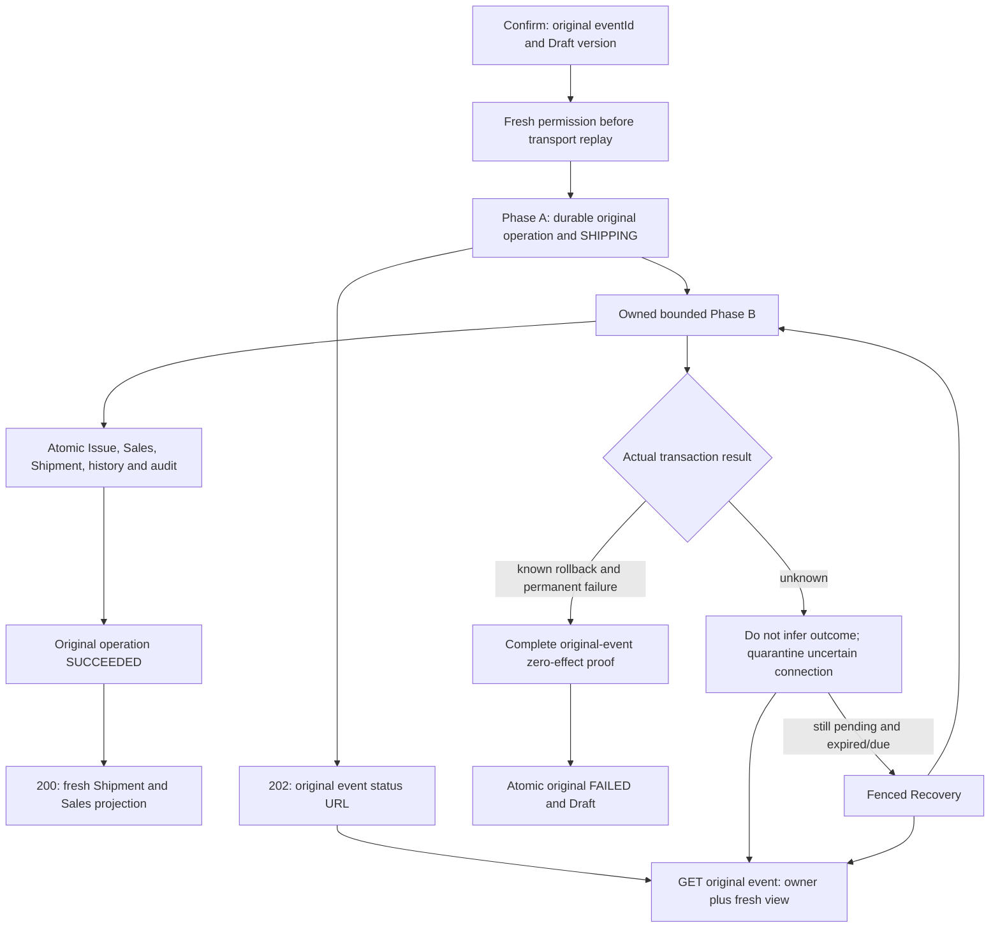

# TASK-028 / TASK-029 — Reviewable confirmation and original-event recovery

Status: IMPLEMENT increment, resumed by Sam on 2026-11-03 under PM's Shipment confirmation/recovery focus. This is not full TASK/P2, UAT, current CI or release approval. The existing isolated worktree and original failures/evidence are retained. No push, routine-CI batch or non-functional validation was performed for this increment.

Product increment: local commit `b375171a` contains the eight reviewed public-confirmation/lookup source files. Its source fingerprint is unchanged from the last developer runs,6bb6d878…. Older09f325/a326/1f955/f841 raw reports retain their actual HEAD6b2e9; later5869/e041/534 reports retain their actual HEADb375171a. The earlier five-file HTTP component keeps its own FP982227… and exact source closure, rather than being relabeled as a new whole-candidate run.

## Public flow and ownership

The POST accepts only `eventId/version` and the existing framework idempotency key. Phase A locks the original operation and document family, commits SHIPPING plus CONFIRM_START, and returns a private started object. Only the same service instance's private object backed by an actual COMMITTED transaction can start ordinary Phase B. A copied object, duplicate pending result or unknown Phase-A commit cannot mint this authority. Unknown Phase A returns safe503 with the original event URL, without inventing an operation ID or starting another write.

The singleton HTTP runtime owns admitted work, controllers, timers and shutdown drain. Admission is bounded by the actual existing DB pool limit. Fresh authorization before transport-cache replay and the later Phase-A authorization share the original request's monotonic deadline. An internal2.5-second budget reserves response time within the unchanged3-second contract; framework JWT/transport stages retain their original policy. After durable intent acknowledgment, Phase B uses its own bounded signal so a202 response or lost response does not silently abandon an unowned promise. Shutdown stops admission, aborts and drains owned work before dependent DB shutdown. Each business transaction remains bounded by20seconds.

Phase B retains the existing operation nonce/hash/actor/version and DB-clock checks, owner lock order, complete saved membership, CAS, quantity conservation, Inventory receipt verification, Sales projection checks and atomic rollback. HD-027's narrow renewal exception applies only while the real atomic transaction holds the operation's exclusive row lock; it grants no expired or foreign lease authority.

Committed success is immutable. The200 response composes current Shipment and SO quantity projections in one fresh RR snapshot, including a fully fulfilled COMPLETED SO, and returns the original complete movement identities with per-line totals. It does not reuse the Sales eligibility getter for a new Fulfillment. A later read failure cannot rewrite SUCCEEDED or cause another Issue.

The GET is now implemented at `/api/v1/fulfillment-operations/by-event/:eventId`. It uses fresh view permission, the existing original-actor decoder, and current Shipment/Fulfillment/Sales parent binding. It does not lock the operation, so the committed pending intent remains readable while a writer holds that row. Missing, foreign or archived targets have the same404. Invalid journal/source data fail closed. The explicit response contains only event/operation/correlation identities, status, minimal durable result and safe public error fields; it excludes payloads, leases, actor data and addresses. Current status/version need not equal the original durable result.

## Failure and restart boundaries

Recovery retains the original event, actor, target and hash. Its genuine scheduler capability, framework lease and operation nonce are rechecked before new transactions; expired/due CAS admits a bounded attempt. It never makes a new event to retry uncertain work. An eligible original actor follows the same ordinary Phase B. A revoked actor cannot Issue or update Sales; only the separately approved, fully proved failure-only path can close the original operation and restore Draft. See [the registered recovery component](84_registered_recovery_increment.md) and [revoked failure-only component](85_revoked_recovery_failure_only.md).

A rollback attempted while the transaction is still live that fails is INDETERMINATE, destroys/quarantines the connection and does not return it to the pool; HD-026 did not redefine every already-aborted legacy branch. A known business cause inside that unknown transaction is insufficient to infer failure. Unknown commit may already be SUCCEEDED: first read the original-event terminal witness; only an operation actually still IN_PROGRESS and expired/due is eligible for takeover. For live failure finalization and the eligible stale-address scenario below, FAILED/DRAFT requires a genuinely acknowledged rollback plus the complete Inventory/Sales/local original-event negative proof. The approved expired revoked-actor failure-only path instead requires fresh ineligibility, complete ABSENT proof and fenced CAS, without asking that actor to run Phase B. Null, missing schema or uncertain source is not zero effect. Native preclaim INSERTs may have been attempted inside the failed transaction; the guarantee is absence of durable effects after reconciliation, not absence of SQL writes.

## Customer's actual call points

| Path | Actual provider use | Meaning |
| --- | --- | --- |
| `ShipmentService.js:24–25` | Transactional shipping Address and optional Contact guards | Draft parent/purpose/version validation. |
| `ShipmentShippingLookupService.js:20` | Active shipping child choices | UI selection only; not a substitute for Confirm guards. |
| `ShipmentConfirmationService.js:172–173` | `assertAddressUsableInTransaction` and optional `assertContactUsableInTransaction` | Real Phase-B parent/purpose/current-version checks under the transaction. |
| `ShipmentConfirmationService.js:174` | `findById` with `existing_order_fulfillment` | Existing-order Customer projection; does not impose new-sale eligibility. |
| `ShipmentConfirmationService.js:66` | Eligible Recovery calls the same `completeConfirmation` | Repeats the real guards; no bypass provider or extra Customer write. |
| Revoked failure-only / confirmed inquiry and documents | No Customer write; confirmed output uses saved snapshots | Cleanup grants no shipping authority; historical print data are not silently replaced by current Customer values. |

## Actual bounded developer evidence

Private raw reports remain outside the repository. Their own HEAD/source/probe/runner/spec identities are preserved; these rows do not relabel old results as current CI.

| Raw run | Observed result and limit |
| --- | --- |
| `confirm-http-outcome-private-fa26a9414cae` | Original FAIL at startup: disabling the scheduler violated mandatory JWT revocation refresh. No Confirm HTTP/PhaseA/B; not a performance failure. Exact original probe retained. |
| `confirm-http-outcome-private-09f32590a778` |1P/0F/0S, no timeout; two five-unit fixtures/four POSTs: COMPLETED SO200, same-key replay/conflict, controlled202 within the unchanged3000ms assertion, then one native commit/Issue/Shipment. FP982227… |
| `operation-http-visibility-private-a326b143c50d` |1P/0F/0S, no timeout; one five-unit fixture/six GETs: pending under original opX, foreign/missing404,401, minimal success result, fresh revoked403.24 business tables unchanged by reads. FP6bb6d878… |
| `indeterminate-rollback-recovery-private-d1148a076954` | Original functional observer FAIL: two failure-only transactions were misclassified as Phase B. First unknown/quarantine/pending checks completed. Raw/probe retained; no timeout or product failure inferred. |
| `indeterminate-rollback-recovery-private-1f955f550d48` |1P/0F/0S, no timeout; one fixture/two serial workers. Actual unknown rollback/quarantine first keeps pending with17 owner tables and the complete Shipment unchanged. Later real rollback and full negative proof close the same event as FAILED/DRAFTv3 with original actor/correlation/history/audit and zero durable Issue. FP6bb6d878… |
| `two-worker-fence-private-f841739e82d5` |1P/0F/0S, no timeout; one fixture/two real workers. After the old worker's native preparation COMMIT ACK, the replacement finishes once. The resumed old worker actually reads replacement framework ownership and refuses;24 business tables and the replacement's normally released framework lease remain unchanged. This proves the combined framework owner/expiry fence, not an isolated nonce predicate. FP6bb6d878… |
| `interrupted-failure-record-private-5869ce82b3d7` |1P/0F/0S, no timeout; exact FAILED-audit native1644/45000/tag with actual acknowledged rollback restores all24 tables, including the original pending nonce/count1. Removing only the fixture trigger lets the second original-event worker record one FAILED/DRAFTv3 result;17 owner tables stay unchanged. |
| `native-deadlock-recovery-private-e041eb52b78f` |1P/0F/0S, no timeout; the actual prepare transaction is the native1213/40001 victim, with real ROLLED_BACK outcome and rollback ACK. All24 tables stay unchanged before the one subsequent original-event success/count2/Issue3. No timeout settings or data volume were increased. |
| `renewal-shutdown-private-5346786500fb` |1P/0F/0S, no runner timeout; deliberate Scheduler.stop aborts the first real B transaction, quarantines its connection and leaves23 business/local tables unchanged. Existing Scheduler stats classify that exact shutdown signal as timeouts1; this is not an actual20-second failure. A serial fresh worker publishes a real same-nonce/hash31-second renewal with actual COMMITTED evidence before B, then produces one success/count3/Issue3. The legal31-second setting is fixture-only; the60-second default and20-second DB ceiling are unchanged. |

Independent closure receipts are private `independent-p2-owned-http-confirm-actual-component-closure-20261103.json` (SHA521d3612…), `independent-p2-task028-operation-get-exact1-actual-result-review.json` (SHA09b7f63d…), and `independent-p2-indeterminate-rollback-recovery-actual-component-closure-review.json` (SHAd291daf6…). Each is a real separate-agent review of exact source and raw artifacts, with0C/H/M limited to its stated component. Earlier native commit-ACK-loss, restart, revoked cleanup, rollback and owner-proof evidence retains its original baseline; the existing core methods are unchanged by this public API increment.

The two-worker closure is private `independent-p2-recovery-lease-two-worker-exact1-actual-result-review.json` (SHA335ce8f9…). Post-run no-client/no-child-schema inspection is separately recorded as Root's actual read-only runtime observation (SHA91451d74…), not independent live SQL verification by the reviewer.

Additional separate-agent closures are `independent-p2-interrupted-revoked-failure-record-actual-component-closure-review.json` (SHA37d48bad…), `independent-p2-recovery-lease-native-deadlock-exact1-actual-result-review.json` (SHA0f0f15ce…), and `independent-p2-recovery-lease-renewal-shutdown-exact1-actual-result-review.json` (SHA9904f0ff…). They bind each exact candidate/raw run and retain the distinction between intentional shutdown counters, whole-fixture time and actual transaction/HTTP limits. The earlier runtime observation predates these last runs and is not reused as proof of their later live cleanup state.

After all seven scoped successful runs, Root separately verified the exact socket-only server identity, no other DB clients and no child fixture schemas. `post-functional-20261103-final-runtime.json` has SHA7131d047… and is a Root observation, not independent reviewer SQL execution. The synthetic base and owned idle server are retained for remaining P2 work.

## Remaining verification and handoff

The named native prepare-deadlock, renewal/abort/shutdown and late FAILED-audit interruption subscenarios now have the bounded results above. This does not establish every mid-posting fault or an isolated nonce-only race. Public Phase-A unknown-error mapping is statically reviewed; this increment does not claim a real network cut or all failure-boundary HTTP coverage. UI/client polling integration, actual Playwright, affected functional coverage/regression, newest-main impact reconciliation and exact-candidate admitted CI remain outstanding. No full TASK028/029/P2 or draft-PR readiness claim is made.

The parallel Sales handoff is read-only: the four original Update cases retain their ID/membership/100-line ordinary-function/late-INSERT risks. DEC051 B supports the same-source quantity pilot; full replacement remains deferred. Exact assertion changes and targeted execution costs belong in Sales's consolidated proposal to Sam. Nothing in this increment edits0106, deletes/skips those cases, grants a new test blob or waits for deferred full replacement. Owner receipt `independent-p2-dec051-b-r9-main-relative-four-update-cases-owner-confirmation.json` has SHA49a49fa2…; the original14P/3F and unexecuted setup-order proposal are preserved separately from Fulfillment results.

All non-functional validation is deferred until the relevant feature has completed UAT, locally and in CI. The Fulfillment owner retains the original capacity catalog, workloads, quantities and thresholds, including5000-member/Balance scenarios and20-second transactions; proposal75's three new capacity scenarios are not executed or newly approved here. Post-UAT capacity must follow main-only explicit dispatch with a verified related-change baseline and the external revision/case grant. No threshold, workload, safety assertion, coverage floor or necessary review has been removed.
